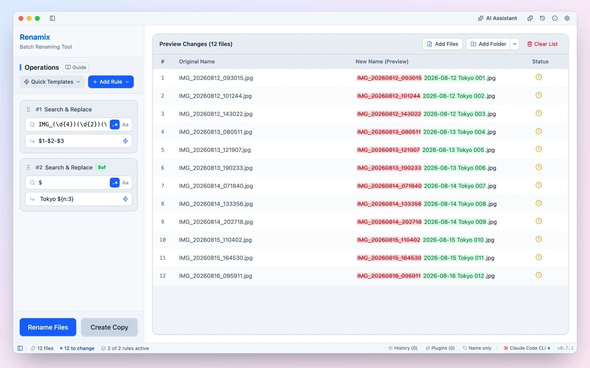
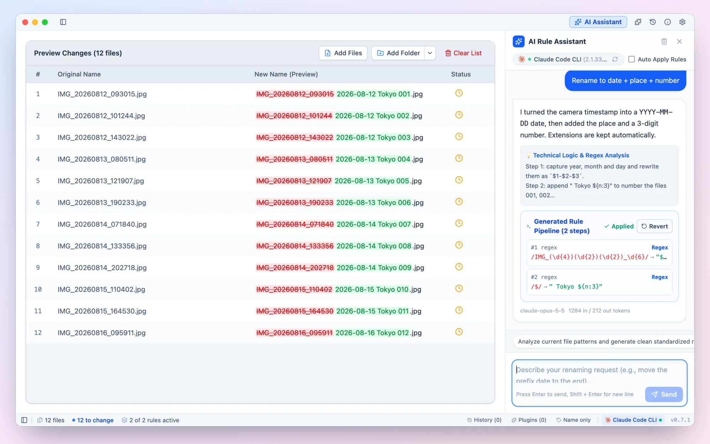
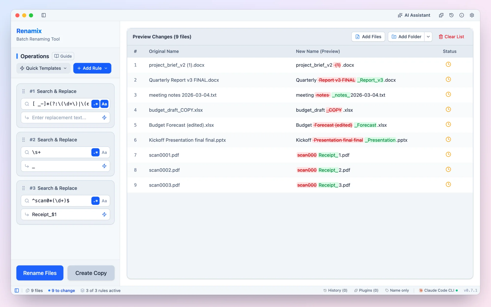
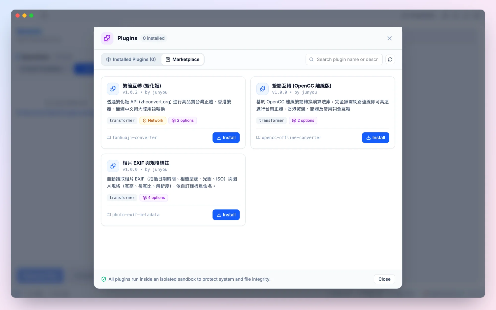
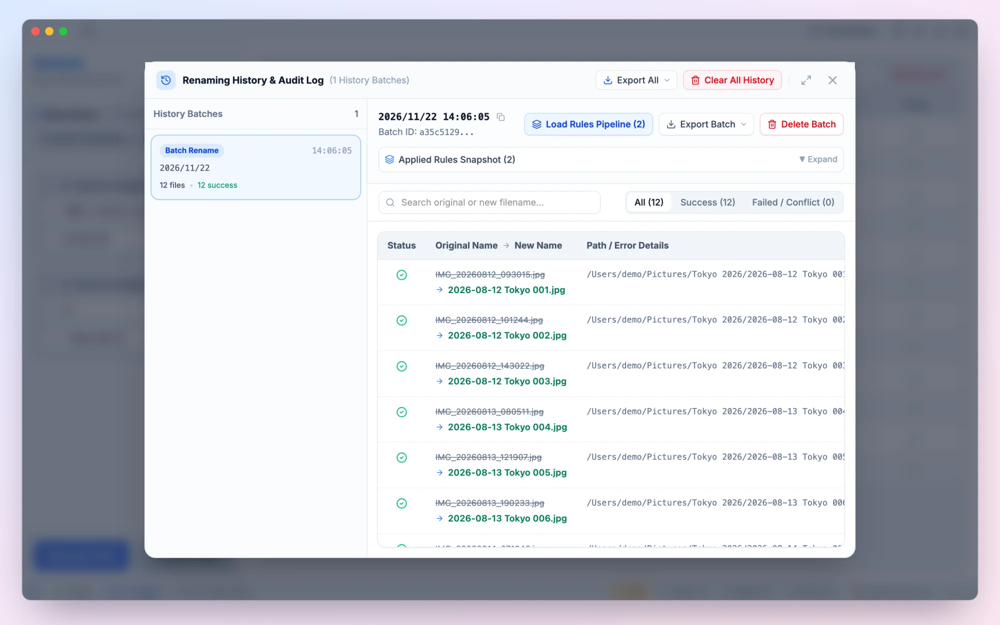
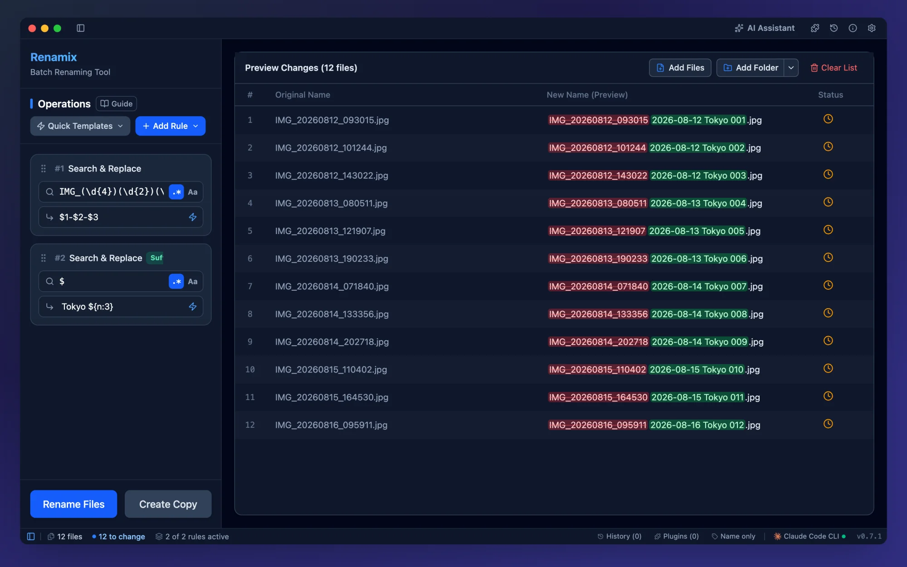

<div align="center">


# Renamix

**Batch file renamer with regex, plugins & AI — for macOS, Windows and Linux.**

<sub>Formerly <b>Regex Batch Renamer</b></sub>

[繁體中文](README.zh-TW.md) · [简体中文](README.zh-CN.md) · **English**

[Website](https://renamix.junyou.tw/) · [Download](https://github.com/junyou1998/renamix/releases/latest) · [Plugins](https://github.com/junyou1998/regex-batch-renamer-plugins)

</div>



Renamix renames hundreds of files in one go. Stack find-and-replace rules, see every new name before anything changes, and undo with one click. Don't know regex? Describe what you want and the AI assistant writes the rules for you.

## ✨ Highlights

- **Live preview, step by step** — Rules run top to bottom as a pipeline. Every new name is previewed with a highlighted diff, and conflicts are flagged before you rename.
- **Safe by design** — Renames run as one transaction: swaps (`a ↔ b`), numbered chains and case-only changes just work, and if anything fails the whole batch rolls back. Copies never overwrite existing files. Undo the last batch with `⌘/Ctrl + Z`.
- **Regex or plain text** — Toggle `.*` for regular expressions and `Aa` to ignore case. Capture groups (`$1`), sequence numbers (`${n:3}`) and quick templates are built in.
- **AI assistant** — Describe the rename in your own words. Works with the Claude Code, Codex or Grok CLI you already use, or with Gemini, OpenAI, Anthropic and local Ollama keys. Suggestions are previewed before they apply and can be reverted.
- **Plugins** — Install converters such as Simplified ↔ Traditional Chinese or photo EXIF naming from the marketplace. Plugins run in an isolated sandbox with only the permissions they declare.
- **History & audit log** — Every rename, copy and undo is recorded; reload past rules or export the log as CSV / JSON.
- **Built for everyday use** — Add a folder's files (optionally with subfolders) or rename folders themselves, keyboard shortcuts, light & dark themes, and English, 繁體中文, 简体中文 and 日本語.

## 📸 Screenshots

| AI assistant | Clean up messy names |
| --- | --- |
|  |  |
| **Plugin marketplace** | **History & audit log** |
|  |  |

<details>
<summary>Dark theme</summary>
<br />

</details>

## 📥 Install

Download the latest version from [GitHub Releases](https://github.com/junyou1998/renamix/releases/latest):

| Platform | File |
| --- | --- |
| macOS (Apple Silicon / Intel) | `.dmg` |
| Windows (64-bit) | `-setup.exe` |
| Linux | `.AppImage` or `.deb` |

The app updates itself when a new version is out.

**macOS note:** builds aren't notarized yet. If macOS says the app is damaged or can't be opened, run:

```bash
xattr -r -d com.apple.quarantine "/Applications/Renamix.app"
```

## 🚀 Quick start

1. **Add files** — drag files or folders into the window, or use **Add Files / Add Folder** (`⌘/Ctrl + O`).
2. **Add a rule** — click **+ Add Rule** or pick a **Quick Template**. Type what to find and what to replace it with.
3. **Check the preview** — the right side shows every new name; problems are marked in red.
4. **Rename** — click **Rename Files** (`⌘/Ctrl + Enter`), or **Create Copy** to write renamed copies to another folder.

Press `F1` or `⌘/Ctrl + /` any time for the built-in guide and regex basics.

## 📖 Regex & numbering cheat sheet

| Find | Replace with | Result |
| --- | --- | --- |
| `\s+` | `_` | `my file name.txt` → `my_file_name.txt` |
| `(\d{4})(\d{2})(\d{2})` | `$1-$2-$3` | `20231125.jpg` → `2023-11-25.jpg` |
| `\s*\([^)]*\)` | *(empty)* | `File (copy).txt` → `File.txt` |
| `^.*` | `Photo_${n:3}` | → `Photo_001`, `Photo_002`, … |

Sequence variables: `${n}` → 1, 2, 3 · `${n:3}` → 001, 002 · `${n:3:10}` → 010, 011 (width : start).

## 🤖 AI assistant

1. Open **✨ AI Assistant** in the title bar.
2. Pick a connection:
   - **CLI** — Claude Code, Codex or Grok CLI you're already signed in to. No API key; it uses the CLI's current model.
   - **API key** — add Gemini, OpenAI or Anthropic in **Settings › AI Assistant**, or connect a local Ollama. Keys are stored only on your computer.
3. Ask in plain words, for example:
   - "Rename `IMG_20260812_093015.jpg` to `2026-08-12_Tokyo_001.jpg`"
   - "Remove 'final', 'copy' and '(1)', then replace spaces with underscores"
   - "Explain what the current rules do"
4. Review the suggested rules, click **Apply**, and **Revert** if you change your mind.

**Privacy:** each request sends your message, the current rules and up to 30 filenames. File contents are never sent.

## 🧩 Plugins

Open **Plugins** in the title bar to browse the [plugin marketplace](https://github.com/junyou1998/regex-batch-renamer-plugins) or install a `.rbr-plugin` file. Before installing you'll see which permissions a plugin asks for (network access, reading the files you added). Plugins run in an isolated worker and can't reach anything else.

## ⌨️ Keyboard shortcuts

| Action | Shortcut |
| --- | --- |
| Rename | `⌘/Ctrl + Enter` |
| Undo last rename | `⌘/Ctrl + Z` |
| Add files | `⌘/Ctrl + O` |
| Open the guide | `F1` or `⌘/Ctrl + /` |
| Zoom in / out / reset | `⌘/Ctrl + +` / `−` / `0` |
| Close a dialog | `Esc` |

## 🛠️ Development

Built with [Tauri v2](https://v2.tauri.app/) (Rust), [Vue 3](https://vuejs.org/), [Pinia](https://pinia.vuejs.org/), [Tailwind CSS v4](https://tailwindcss.com/) and [Vue I18n](https://vue-i18n.intlify.dev/).

```bash
pnpm install          # install dependencies
pnpm dev              # run the desktop app with hot reload
pnpm tauri:ci         # type-check and build the frontend
pnpm build            # build a release bundle
pnpm demo             # run the UI in a browser with demo files (no Tauri)
```

Regenerate the screenshots in this README (needs Google Chrome and `cwebp`):

```bash
pnpm demo                                # terminal 1
node scripts/capture-screenshots.mjs     # terminal 2
```

## ☕ Support

If Renamix saves you time, you can support development:

<a href="https://www.buymeacoffee.com/junyou" target="_blank"></a>

## 📄 License

[MIT](LICENSE)
