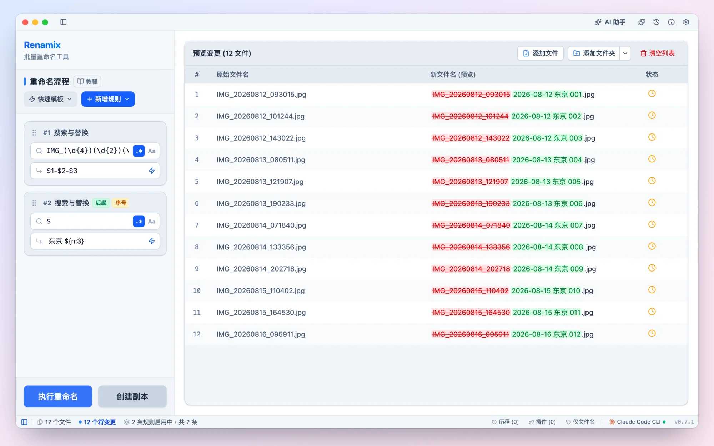
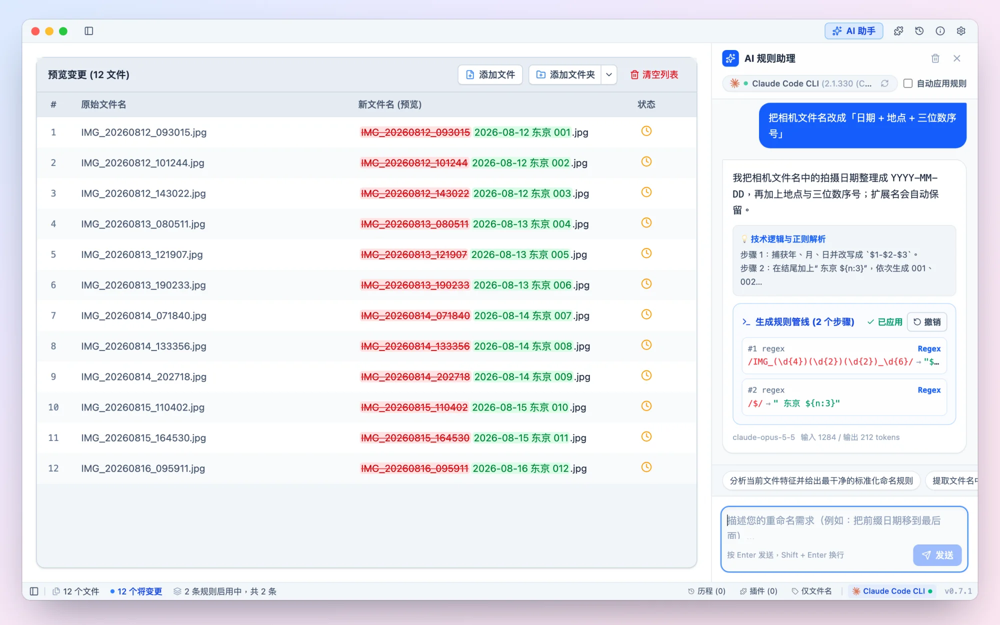
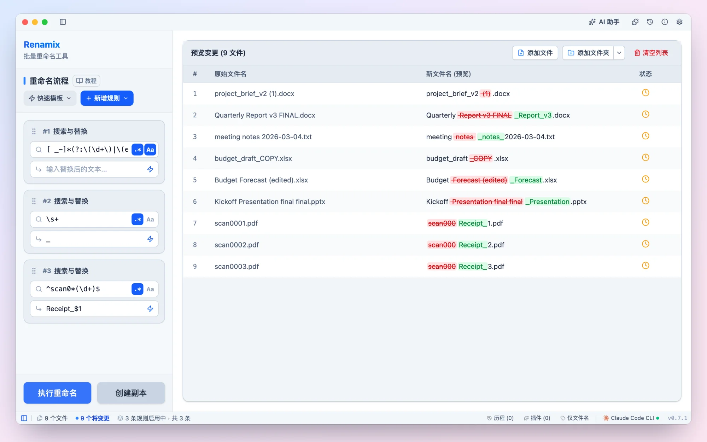
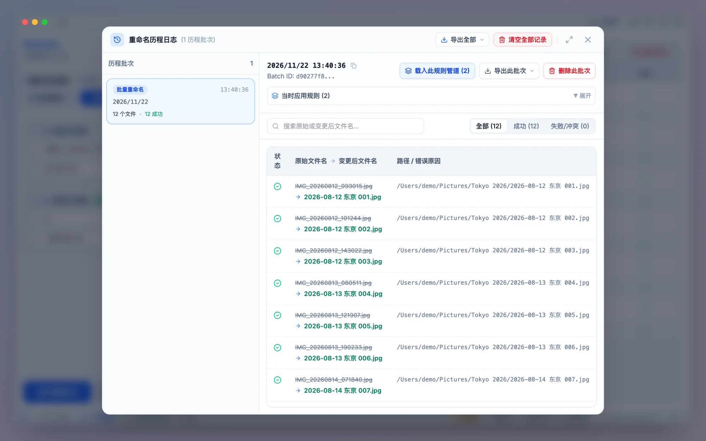
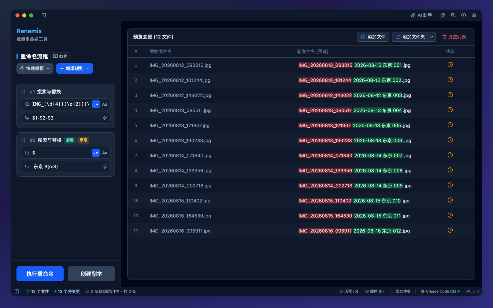

<div align="center">


# Renamix

**支持 Regex、插件与 AI 的批量文件重命名工具，适用于 macOS、Windows 与 Linux。**

<sub>原名 <b>Regex Batch Renamer</b></sub>

[繁體中文](README.zh-TW.md) · **简体中文** · [English](README.md)

[官方网站](https://renamix.junyou.tw/) · [下载](https://github.com/junyou1998/renamix/releases/latest) · [插件](https://github.com/junyou1998/regex-batch-renamer-plugins)

</div>



Renamix 能一次重命名上百个文件。把多条“查找与替换”规则串起来，在真正修改之前先预览每一个新文件名，不满意一键撤销。不会写 Regex 也没关系，用普通的话描述，AI 助手会帮你生成规则。

## ✨ 特色

- **逐步实时预览**：规则从上到下依次应用，每个新文件名都以醒目的差异标示预览；重命名前就会标出文件名冲突。
- **安全第一**：整批重命名以“事务”方式执行，互换（`a ↔ b`）、连锁编号、仅修改大小写都能正确处理；只要有一个失败，整批自动还原。创建副本时绝不覆盖已有文件。按 `⌘/Ctrl + Z` 撤销上一批。
- **Regex 或普通文字**：`.*` 切换正则表达式、`Aa` 切换不区分大小写；内置捕获分组（`$1`）、序号（`${n:3}`）与快速模板。
- **AI 助手**：用自己的话描述想怎么重命名。可直接使用你已登录的 Claude Code、Codex、Grok CLI，或 Gemini、OpenAI、Anthropic、本机 Ollama。建议会先预览、确认后才应用，也能一键还原。
- **插件**：从插件市场安装繁简转换、照片 EXIF 命名等功能。插件在隔离沙箱中运行，只能使用它声明的权限。
- **历史与审计记录**：每次重命名、复制与撤销都会记录，可重新加载当时的规则，或导出为 CSV / JSON。
- **日常好用**：可添加文件夹内的文件（含子文件夹）或直接重命名文件夹、完整的键盘快捷键、浅色与深色主题，界面支持繁中、简中、English、日本語。

## 📸 界面截图

| AI 助手 | 整理杂乱文件名 |
| --- | --- |
|  |  |
| **插件市场** | **历史与审计记录** |
|  |  |

<details>
<summary>深色主题</summary>
<br />

</details>

## 📥 下载安装

前往 [GitHub Releases](https://github.com/junyou1998/renamix/releases/latest) 下载最新版本：

| 平台 | 文件 |
| --- | --- |
| macOS（Apple Silicon / Intel） | `.dmg` |
| Windows（64 位） | `-setup.exe` |
| Linux | `.AppImage` 或 `.deb` |

有新版本时，App 会自动提示并更新。

**macOS 用户注意：** 目前尚未经过 Apple 公证。若系统提示“已损坏”或“无法打开”，请在终端执行：

```bash
xattr -r -d com.apple.quarantine "/Applications/Renamix.app"
```

## 🚀 快速开始

1. **添加文件**：把文件或文件夹拖进窗口，或点击“添加文件 / 添加文件夹”（`⌘/Ctrl + O`）。
2. **新增规则**：点击“+ 新增规则”或选择“快速模板”，输入要查找的文字与要替换成的内容。
3. **检查预览**：右侧会显示每个新文件名，有问题的会以红色标示。
4. **执行**：点击“执行重命名”（`⌘/Ctrl + Enter`），或“创建副本”把重命名后的文件复制到其他文件夹。

随时按 `F1` 或 `⌘/Ctrl + /` 打开内置的使用说明与 Regex 教程。

## 📖 Regex 与序号速查

| 查找 | 替换为 | 结果 |
| --- | --- | --- |
| `\s+` | `_` | `my file name.txt` → `my_file_name.txt` |
| `(\d{4})(\d{2})(\d{2})` | `$1-$2-$3` | `20231125.jpg` → `2023-11-25.jpg` |
| `\s*\([^)]*\)` | （留空） | `File (copy).txt` → `File.txt` |
| `^.*` | `Photo_${n:3}` | → `Photo_001`、`Photo_002`… |

序号变量：`${n}` → 1、2、3 · `${n:3}` → 001、002 · `${n:3:10}` → 010、011（位数 : 起始值）。

## 🤖 AI 助手

1. 点击标题栏的“✨ AI 助手”。
2. 选择连接方式：
   - **CLI**：使用你已登录的 Claude Code、Codex 或 Grok CLI，不需要 API Key，会沿用 CLI 当前设置的模型。
   - **API Key**：到“设置 › AI 助手”添加 Gemini、OpenAI、Anthropic，或连接本机的 Ollama。Key 只保存在你的电脑上。
3. 用普通的话提问，例如：
   - “把 `IMG_20260812_093015.jpg` 改成 `2026-08-12_东京_001.jpg`”
   - “删掉 final、copy、(1)，并把空格换成下划线”
   - “解释当前的规则在做什么”
4. 检查建议的规则后点击“应用”，不满意就点“撤销”。

**隐私：** 每次提问会发送你的消息、当前的规则与最多 30 个文件名，不会发送文件内容。

## 🧩 插件

点击标题栏的“插件”即可浏览[插件市场](https://github.com/junyou1998/regex-batch-renamer-plugins)，或安装 `.rbr-plugin` 文件。安装前会列出插件请求的权限（网络连接、读取你添加的文件）。插件在隔离的 Worker 中运行，无法访问其他资源。

## ⌨️ 键盘快捷键

| 操作 | 快捷键 |
| --- | --- |
| 执行重命名 | `⌘/Ctrl + Enter` |
| 撤销上一次重命名 | `⌘/Ctrl + Z` |
| 添加文件 | `⌘/Ctrl + O` |
| 打开使用说明 | `F1` 或 `⌘/Ctrl + /` |
| 放大 / 缩小 / 重置缩放 | `⌘/Ctrl + +` / `−` / `0` |
| 关闭对话框 | `Esc` |

## 🛠️ 开发

基于 [Tauri v2](https://v2.tauri.app/)（Rust）、[Vue 3](https://vuejs.org/)、[Pinia](https://pinia.vuejs.org/)、[Tailwind CSS v4](https://tailwindcss.com/) 与 [Vue I18n](https://vue-i18n.intlify.dev/) 构建。

```bash
pnpm install          # 安装依赖
pnpm dev              # 启动桌面版（支持热重载）
pnpm tauri:ci         # 类型检查并构建前端
pnpm build            # 构建正式版安装包
pnpm demo             # 在浏览器中以示例文件运行界面（无需 Tauri）
```

重新生成本文档中的截图（需要 Google Chrome 与 `cwebp`）：

```bash
pnpm demo                                # 终端 1
node scripts/capture-screenshots.mjs     # 终端 2
```

## ☕ 支持开发

如果 Renamix 帮你节省了时间，欢迎请我喝杯咖啡：

<a href="https://www.buymeacoffee.com/junyou" target="_blank"></a>

## 📄 许可证

[MIT](LICENSE)
