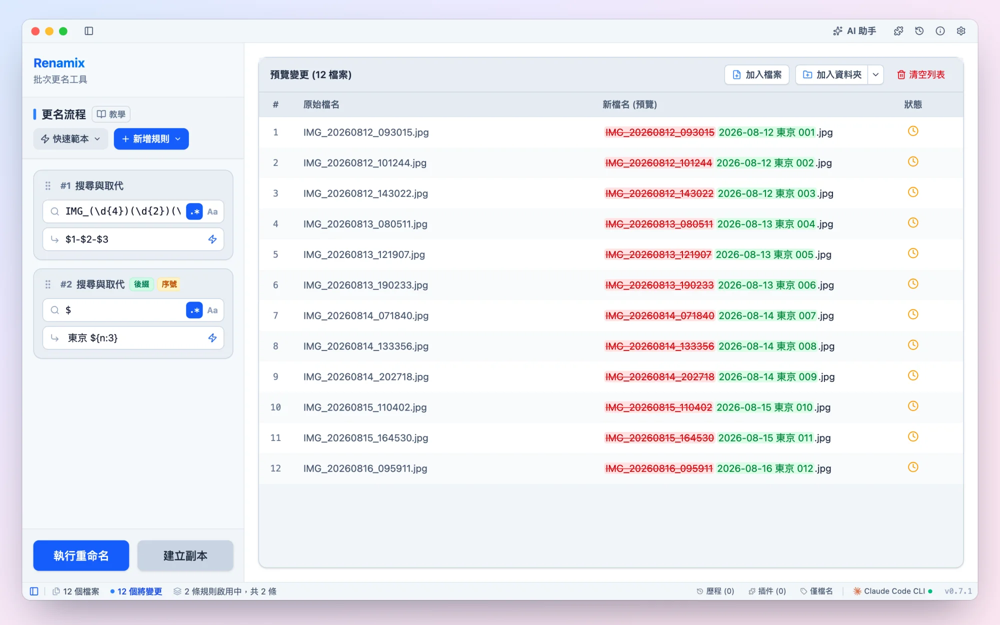
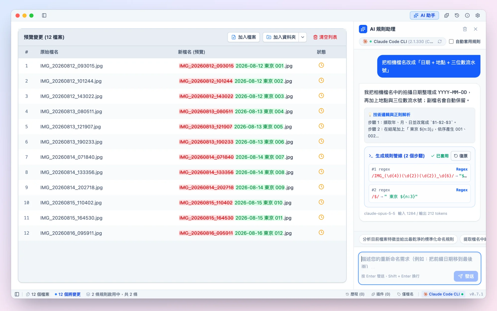
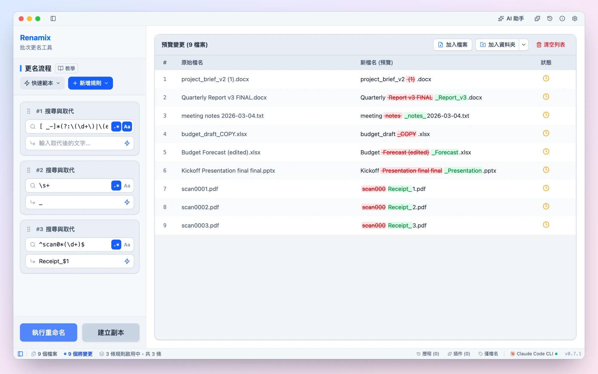
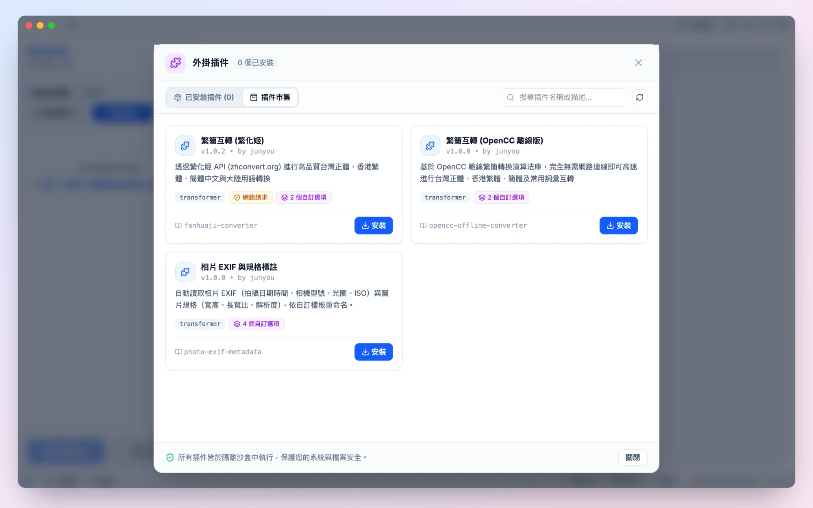
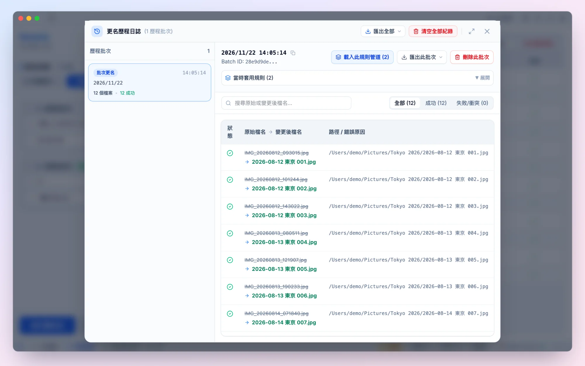
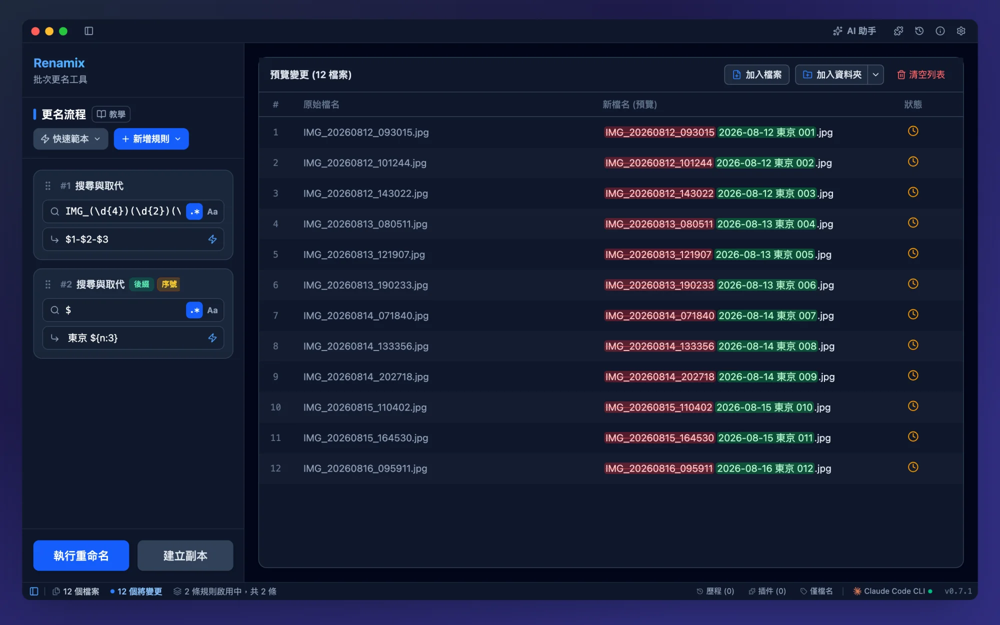

<div align="center">


# Renamix

**支援 Regex、外掛與 AI 的批次檔案更名工具，適用 macOS、Windows 與 Linux。**

<sub>原名 <b>Regex Batch Renamer</b></sub>

**繁體中文** · [简体中文](README.zh-CN.md) · [English](README.md)

[官方網站](https://renamer.junyou.tw/) · [下載](https://github.com/junyou1998/regex-batch-renamer/releases/latest) · [外掛](https://github.com/junyou1998/regex-batch-renamer-plugins)

</div>



Renamix 能一次更名上百個檔案。把多條「尋找與取代」規則串起來，在真正修改之前先預覽每一個新檔名，不滿意一鍵復原。不會寫 Regex 也沒關係，用一般的話描述，AI 助理會幫你產生規則。

## ✨ 特色

- **逐步即時預覽**：規則由上而下依序套用，每個新檔名都以醒目的差異標示預覽；更名前就會標出檔名衝突。
- **安全第一**：整批更名以「交易」方式執行，互換（`a ↔ b`）、連鎖編號、只改大小寫都能正確處理；只要有一個失敗，整批自動還原。建立副本時絕不覆蓋既有檔案。按 `⌘/Ctrl + Z` 復原上一批。
- **Regex 或一般文字**：`.*` 切換正規表示式、`Aa` 切換不分大小寫；內建擷取群組（`$1`）、流水號（`${n:3}`）與快速範本。
- **AI 助理**：用自己的話描述想怎麼改名。可直接使用你已登入的 Claude Code、Codex、Grok CLI，或 Gemini、OpenAI、Anthropic、本機 Ollama。建議會先預覽、確認後才套用，也能一鍵還原。
- **外掛**：從外掛市集安裝繁簡轉換、照片 EXIF 命名等功能。外掛在隔離沙盒中執行，只能使用它宣告的權限。
- **歷史與稽核紀錄**：每次更名、複製與復原都會記錄，可重新載入當時的規則，或匯出成 CSV / JSON。
- **日常好用**：可加入資料夾內的檔案（含子資料夾）或直接更名資料夾、完整的鍵盤快捷鍵、淺色與深色主題，介面支援繁中、简中、English、日本語。

## 📸 畫面截圖

| AI 助理 | 整理雜亂檔名 |
| --- | --- |
|  |  |
| **外掛市集** | **歷史與稽核紀錄** |
|  |  |

<details>
<summary>深色主題</summary>
<br />

</details>

## 📥 下載安裝

到 [GitHub Releases](https://github.com/junyou1998/regex-batch-renamer/releases/latest) 下載最新版本：

| 平台 | 檔案 |
| --- | --- |
| macOS（Apple Silicon / Intel） | `.dmg` |
| Windows（64 位元） | `-setup.exe` |
| Linux | `.AppImage` 或 `.deb` |

有新版本時，App 會自動提示並更新。

**macOS 使用者注意：** 目前尚未經過 Apple 公證。若系統顯示「已損毀」或「無法打開」，請在終端機執行：

```bash
xattr -r -d com.apple.quarantine "/Applications/Renamix.app"
```

## 🚀 快速開始

1. **加入檔案**：把檔案或資料夾拖進視窗，或點「加入檔案 / 加入資料夾」（`⌘/Ctrl + O`）。
2. **新增規則**：點「+ 新增規則」或選擇「快速範本」，輸入要尋找的文字與要取代成的內容。
3. **檢查預覽**：右側會顯示每個新檔名，有問題的會以紅色標示。
4. **執行**：點「執行重命名」（`⌘/Ctrl + Enter`），或「建立副本」把改好名的檔案複製到其他資料夾。

隨時按 `F1` 或 `⌘/Ctrl + /` 開啟內建的使用說明與 Regex 教學。

## 📖 Regex 與流水號速查

| 尋找 | 取代為 | 結果 |
| --- | --- | --- |
| `\s+` | `_` | `my file name.txt` → `my_file_name.txt` |
| `(\d{4})(\d{2})(\d{2})` | `$1-$2-$3` | `20231125.jpg` → `2023-11-25.jpg` |
| `\s*\([^)]*\)` | （留空） | `File (copy).txt` → `File.txt` |
| `^.*` | `Photo_${n:3}` | → `Photo_001`、`Photo_002`… |

流水號變數：`${n}` → 1、2、3 · `${n:3}` → 001、002 · `${n:3:10}` → 010、011（位數 : 起始值）。

## 🤖 AI 助理

1. 點標題列的「✨ AI 助手」。
2. 選擇連線方式：
   - **CLI**：使用你已登入的 Claude Code、Codex 或 Grok CLI，不需要 API Key，會沿用 CLI 目前設定的模型。
   - **API Key**：到「設定 › AI 助理」加入 Gemini、OpenAI、Anthropic，或連接本機的 Ollama。Key 只存在你的電腦上。
3. 用一般的話提問，例如：
   - 「把 `IMG_20260812_093015.jpg` 改成 `2026-08-12_東京_001.jpg`」
   - 「刪掉 final、copy、(1)，並把空白換成底線」
   - 「解釋目前的規則在做什麼」
4. 檢查建議的規則後按「套用」，不滿意就按「復原」。

**隱私：** 每次提問會送出你的訊息、目前的規則與最多 30 個檔名，不會送出檔案內容。

## 🧩 外掛

點標題列的「外掛」即可瀏覽[外掛市集](https://github.com/junyou1998/regex-batch-renamer-plugins)，或安裝 `.rbr-plugin` 檔案。安裝前會列出外掛要求的權限（網路連線、讀取你加入的檔案）。外掛在隔離的 Worker 中執行，無法存取其他資源。

## ⌨️ 鍵盤快捷鍵

| 動作 | 快捷鍵 |
| --- | --- |
| 執行重命名 | `⌘/Ctrl + Enter` |
| 復原上一次更名 | `⌘/Ctrl + Z` |
| 加入檔案 | `⌘/Ctrl + O` |
| 開啟使用說明 | `F1` 或 `⌘/Ctrl + /` |
| 放大 / 縮小 / 重設縮放 | `⌘/Ctrl + +` / `−` / `0` |
| 關閉對話框 | `Esc` |

## 🛠️ 開發

使用 [Tauri v2](https://v2.tauri.app/)（Rust）、[Vue 3](https://vuejs.org/)、[Pinia](https://pinia.vuejs.org/)、[Tailwind CSS v4](https://tailwindcss.com/) 與 [Vue I18n](https://vue-i18n.intlify.dev/) 打造。

```bash
pnpm install          # 安裝相依套件
pnpm dev              # 啟動桌面版（支援熱重載）
pnpm tauri:ci         # 型別檢查並建置前端
pnpm build            # 建置正式版安裝檔
pnpm demo             # 在瀏覽器中以示範檔案執行介面（不需 Tauri）
```

重新產生本文件中的截圖（需要 Google Chrome 與 `cwebp`）：

```bash
pnpm demo                                # 終端機 1
node scripts/capture-screenshots.mjs     # 終端機 2
```

## ☕ 支持開發

如果 Renamix 幫你省下了時間，歡迎請我喝杯咖啡：

<a href="https://www.buymeacoffee.com/junyou" target="_blank"></a>

## 📄 授權

[MIT](LICENSE)
